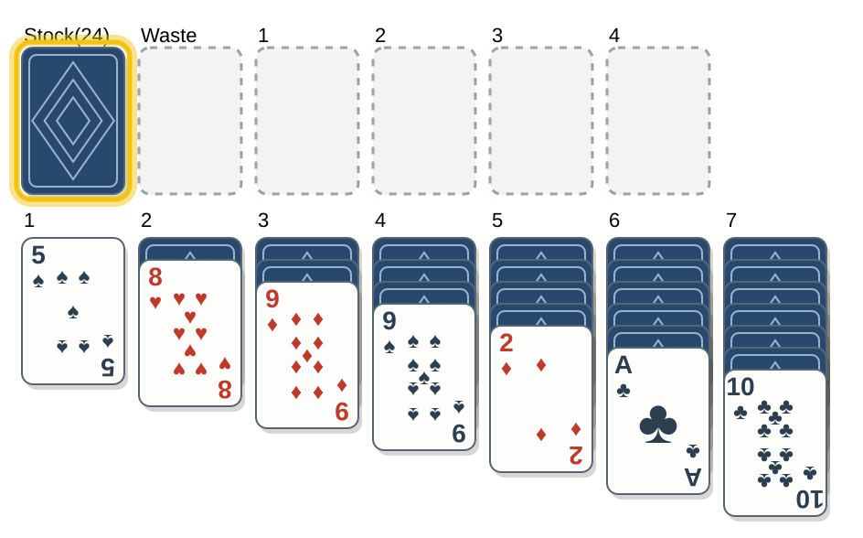
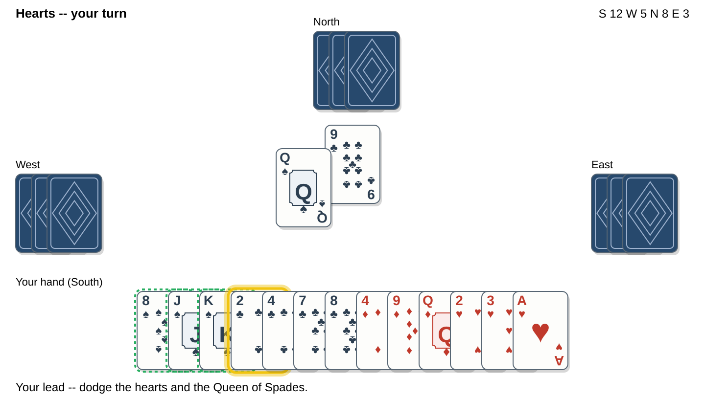

#+TITLE: card-games -- Play card games in Emacs
#+AUTHOR: Corwin Brust
#+OPTIONS: toc:nil

Card games for Emacs: about thirty of them, from Klondike and FreeCell
to Hearts, 500, Gin, Cribbage, and two-player Russian Bank against the
computer.  Every game plays with the keyboard everywhere and with the
mouse on a graphical display.

On a graphical display the cards are drawn as SVG; in a terminal they
fall back to UNICODE glyphs (customize ~card-games-symbols~).  You can
switch how every game is drawn from the menu -- ~text~ (UNICODE),
~svg~ (drawn cards), or ~full~ (a full-window SVG table) -- and dial the
computer opponents between ~easy~, ~normal~, and ~hard~.

A full Info manual ships with the package: after installing, ~C-h i~ and
choose *Card Games*, or ~M-x info RET (card-games) RET~.

* Games

To open the game menu type ~M-x card-games~, or start a game directly
with its command.  From the menu you can also switch the card treatment
(text / SVG / full-window) and the AI difficulty.

** Trick-taking
- ~card-games-bid~ -- 500 (Bid).  Win the auction, name the trump suit, then take
  tricks with your partner to reach 500 points before the opposing pair.
  Also playable live over the network (~M-x card-games-bid-host~ / ~card-games-bid-join~).
- ~card-games-hearts~ -- Hearts.  Avoid taking hearts and the Queen of Spades, or
  take them all to "shoot the moon"; lowest score loses.
- ~card-games-spades~ -- Spades.  Partnership bidding to 500; spades are always
  trump.  Make your side's combined bid, mind the bags, dare a nil.
- ~card-games-whist~ -- Whist.  Trump is the turned card, there is no bidding;
  score one point for each trick past the book of six.
- ~card-games-ohhell~ -- Oh Hell.  The hand shrinks each round; bid the exact
  number of tricks you will take, no more and no fewer.

** Solitaire
- ~card-games-montana~ -- Montana (also called Gaps).  Each row is anchored by a
  Two and built upward in one suit, 2 through King; slide cards into the
  gaps until all four rows are sorted.
- ~card-games-gaps~ -- an alias for ~card-games-montana~.
- ~card-games-hells-half-acre~ -- the build-down variant: each row is anchored by
  a King and built downward, King through 2.
- ~card-games-klondike~ -- Klondike, the classic "Solitaire": build the four
  foundations up by suit from the Ace.
- ~card-games-freecell~ -- FreeCell: every card in view, four free cells, a game
  of nearly pure skill.
- ~card-games-spider~ -- Spider (two decks): build down regardless of suit, but
  only same-suit runs move; clear eight King-to-Ace runs.
- ~card-games-yukon~ -- Yukon: Klondike's layout dealt mostly face up, with any
  buried group movable and no stock.
- ~card-games-canfield~ -- Canfield: a 13-card reserve and a foundation base rank
  set by the deal; foundations wrap King to Ace.
- ~card-games-forty-thieves~ -- Forty Thieves: two decks, ten columns, eight
  foundations, build down by suit, and no second pass through the stock.
- ~card-games-scorpion~ -- Scorpion: build down by suit and free any buried group
  to assemble four King-to-Ace runs.
- ~card-games-golf~ -- Golf: clear the layout by playing exposed cards one rank
  above or below the waste top.
- ~card-games-tripeaks~ -- TriPeaks: the same, on three overlapping peaks, with
  Ace-King wrapping for long chains.
- ~card-games-pyramid~ -- Pyramid: remove pairs of exposed cards whose ranks sum
  to thirteen; Kings go alone.

** Shedding and climbing
- ~card-games-eights~ -- Crazy Eights.  Match the suit or rank of the discard;
  eights are wild and let you name the next suit.
- ~card-games-president~ -- President (Scum).  Climb: play one to four of a rank,
  beat it or pass; first out rules, last out scrubs, and the roles trade
  cards on the next deal.

** Rummy
- ~card-games-gin~ -- Gin Rummy.  A two-handed duel: draw or take the discard,
  build sets and runs, and knock once your deadwood is ten or less, or go
  gin with none; your opponent then lays off and may undercut you.  First
  to 100 wins.
- ~card-games-rummy-basic~ -- Rummy.  Meld sets and runs onto the table and lay
  cards off onto them; empty your hand to go out and score the cards left
  in the other hands.
- ~card-games-rum500~ -- Rummy 500.  As above, but you score the cards you lay
  down and lose the cards left in your hand; first past 500 wins.  Take a
  buried discard card with ~T~: you take it and every card above it, and
  meld the chosen card at once.
- ~card-games-handfoot~ -- Hand & Foot.  A partnership Canasta cousin: play a hand
  and then a foot, build books of a rank with Twos and Jokers wild, and go
  out once your side has completed two of them.  Each round opens with a
  rising go-down minimum (50, 90, 120, 150); red threes are bonus cards;
  and you can pick up the discard pile (~p~) by melding its top card with
  two matching naturals.

** Matching
- ~card-games-go-fish~ -- Go Fish.  Ask another player for a rank you hold;
  collect all four to lay down a book, and make the most books.
- ~card-games-old-maid~ -- Old Maid.  One Queen is set aside; discard pairs and
  draw blind from your neighbour, and do not be left with the odd Queen.

** Pegging
- ~card-games-cribbage~ -- Cribbage.  Lay two cards to the crib, cut a starter,
  peg toward 31, then count fifteens, pairs, runs, flushes, and his nobs.
  Two-handed to 121.

** Capturing
- ~card-games-scopa~ -- Scopa.  A 40-card deck; capture table cards by value and
  sweep the board for a scopa.  Score cards, coins, the sette bello, and
  primiera to 11.
- ~card-games-casino~ -- Casino.  The full deck; capture by pairs and sums and
  score cards, spades, the casinos, and aces to 21.

** More trick-taking
- ~card-games-euchre~ -- Euchre.  A 24-card deck with the two bowers; order up or
  call trump and take three of five tricks.  Partnership to 10.
- ~card-games-pitch~ -- Auction Pitch.  Bid for the pitch; your first lead sets
  trump.  Score High, Low, Jack, and Game; first to 7.
- ~card-games-briscola~ -- Briscola.  A fixed trump turned from the deal and no
  obligation to follow suit; capture the Aces and Threes.  Partnership to
  61 of the 120 points.

** Climbing patience
- ~card-games-spite~ -- Spite & Malice.  Race the computer to empty your goal
  pile onto shared centre piles that build Ace to Queen; Kings are wild.

** Bridge
- ~card-games-bridge~ -- Contract Bridge.  A full auction (bids, pass, double,
  redouble), play with the dummy exposed, and classic rubber scoring with
  vulnerability.  You are South; when you declare you play the dummy too.
  The bidding AI is a small natural system, sensible but no expert.

** Two-player patience
- ~card-games-russian-bank~ / ~card-games-crapette~ -- Russian Bank (Crapette).  A race
  against the computer: build the eight shared foundations up by suit,
  build the shared houses down in alternating colour, and empty your
  reserve to win.  Load your cards onto your opponent's piles when the
  rank and suit line up, mind the "stop" rule that ends your turn if you
  skip a foundation play, and sequence house-to-house moves within the
  free houses (~[~ / ~]~ choose how many cards of a run to drop on an
  empty house).  The opponent plays all three difficulty levels.

* TODO
- [X] make the suit symbols customizable (~card-games-symbols~) and obey them
- [X] a Texinfo manual
- [ ] finish ~checkdoc~ docstrings across the per-game files
  (the shared engine files are clean; ~make compile~ is warning-free)
- [ ] renderer "skins": let games subclass the display components (text,
  SVG, full-window SVG)
- [X] a manual card-size control for the full-window SVG UI
- [ ] more games

* Install
** From the package tarball
#+begin_src
make package           # builds card-games-1.0.92.tar
#+end_src
Then in Emacs: ~M-x package-install-file RET card-games-1.0.92.tar~.

** With ~use-package~
Once the package is on your ~load-path~ (installed from the tarball or an
ELPA archive), the whole collection loads from the single ~card-games~
feature:
#+begin_src emacs-lisp
(use-package card-games
  :commands (card-games card-games-klondike card-games-bid card-games-hearts card-games-gin card-games-crapette))
#+end_src
Then ~M-x card-games~ for the menu.

** From a local ELPA archive
#+begin_src
make elpa              # builds dist/ (archive-contents + tar)
#+end_src
#+begin_src emacs-lisp
(add-to-list 'package-archives '("cg" . "/path/to/dist/"))
(package-refresh-contents)
(package-install 'card-games)
#+end_src

** Manually
Put the ~card-games-*.el~ and ~card-games.el~ files on your ~load-path~ and
~(require 'card-games)~.

* Manual
A complete Info manual is included.  After installing, ~C-h i~ and pick
*Card Games*, or ~M-x info RET (card-games) RET~.  To build it from a
source checkout:
#+begin_src
make info              # builds doc/card-games.info with makeinfo
#+end_src
The manual text is licensed CC-BY-4.0; the code is GPL-3.0-or-later.

* Playing
Every game works with the keyboard everywhere and with the mouse on a
graphical display.

- 500: ~b~ bid, ~p~ pass, arrows + ~RET~ to play (or click a card),
  ~n~ next hand / new game, ~?~ help.
- Gaps: arrows to move (or ~hjkl~ when ~card-games-keys~ is ~classic~), ~RET~ to
  fill a gap (or click it), ~r~ redeal, ~u~ undo, ~n~ new, ~?~ help.
- Klondike / FreeCell / Spider / Yukon: arrows move between piles, ~RET~
  picks up a movable run and drops it, ~f~ sends a card to a foundation,
  ~a~ auto-plays everything it can, ~u~ undo, ~n~ new, ~?~ help.  On the
  stock pile, ~RET~ deals or recycles.
- Hearts / Spades: arrows choose a card, ~RET~ plays it (in Hearts, ~RET~
  marks a card to pass and ~p~ sends the three), ~n~ new match, ~?~ help.
- Crazy Eights: arrows choose, ~RET~ plays, ~d~ draws, ~x~ passes, ~n~
  new deal, ~?~ help.

On a graphical display, ~v~ toggles the full-window SVG table.  A
*Card size* slider (and the ~+~ / ~-~ / ~0~ keys) resizes the cards, and
in 500 the ~? Help / Rules~ button explains play.  Every game accepts the
mouse: click cards, board slots, buttons, and the slider.

* Testing
This is a 1.0.92 pre-test snapshot.  To try it:
1. ~make compile && make test~ -- should be warning-free and all green.
2. ~M-x card-games~ opens the menu, or jump straight in, e.g.
   ~M-x card-games-klondike~, ~M-x card-games-bid~ (500), ~M-x card-games-gin~, ~M-x card-games-handfoot~.
3. On a graphical display, press ~v~ in 500 for the full-window SVG
   table and play entirely with the mouse: click a bid, click five kitty
   cards and the *Discard* button, click cards to play, move the *Card
   size* slider, and open ~? Help / Rules~.

Feedback most wanted: anything a mouse-only player who is new to Emacs
finds confusing or unreachable, rules bugs, and rendering glitches.

* Customization
~M-x customize-group RET card-games-svg~ and ~RET card-games~:
- ~card-games-ai-level~ -- how hard the computer plays: ~easy~, ~normal~, or
  ~hard~ (also on the ~M-x card-games~ menu, or ~M-x
  card-games-set-ai-level~).
- ~card-games-treatment~ -- how the games are drawn: ~text~, ~svg~, or
  ~full~ (also on the menu, or ~M-x card-games-set-treatment~).
- ~card-games-svg-theme-colors~ -- derive the highlight ring and card backs
  from your theme (on by default).
- ~card-games-svg-highlight-color~ -- the cursor/selection ring (gold by default).
- ~card-games-bid-felt-color~ -- the 500 table felt.
- ~card-games-svg-card-width~, ~card-games-svg-card-height~, ~card-games-svg-card-shadow~,
  ~card-games-svg-font-family~ -- card appearance.
- ~card-games-svg-card-back~ -- the card-back design: ~dots~, ~rings~, ~solid~,
  ~lattice~, ~waves~, ~diamond~, an Emacs-logo back (~emacs~,
  ~emacs-classic~, ~gnu~, ~splash~), or ~random~ (the default -- picks
  one for the session; ~M-x card-games-svg-shuffle-card-back~ rolls a new one).
- ~card-games-svg-emacs-logo~ -- the emblem on the full-window table:
  ~modern~ (default), ~classic~, ~gnu~, ~splash~, ~drawn~, or ~none~.
- ~card-games-symbols~ -- the Unicode suit glyphs (and the joker) drawn on cards.
- ~card-games-svg-four-color~ -- draw a four-colour deck (clubs green, diamonds
  blue-purple).
- ~card-games-keys~ -- ~emacs~ (default) or ~classic~ (adds vi-style ~hjkl~ and
  ~SPC~).
- ~card-games-bid-animate~, ~card-games-bid-ai-delay~, ~card-games-bid-trick-pause~ -- pace the
  500 AI so play is watchable and completed tricks linger.
- ~M-x card-games-set-theme~ -- apply a preset (classic, dark, contrast).

* Development
#+begin_src
make compile     # byte-compile (should be warning-free)
make test        # run the ERT suite
make checkdoc    # documentation lint
make release     # clean + test + package + source tarball
#+end_src

* License
GPL-3.0-or-later.  See the file headers; add a COPYING file with the
full GPLv3 text for distribution.
